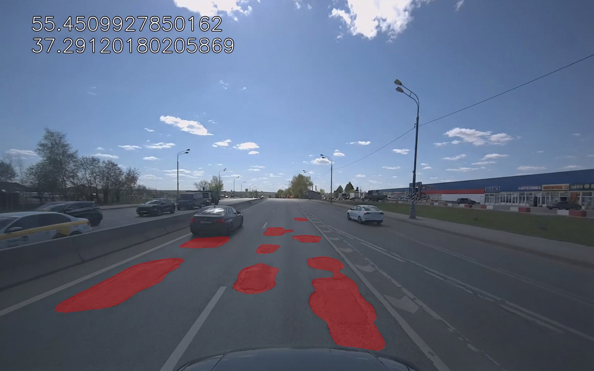
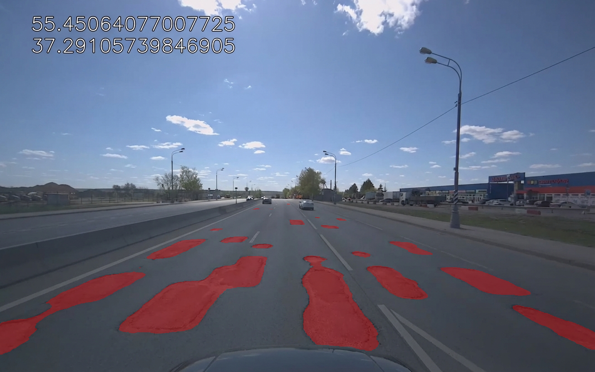
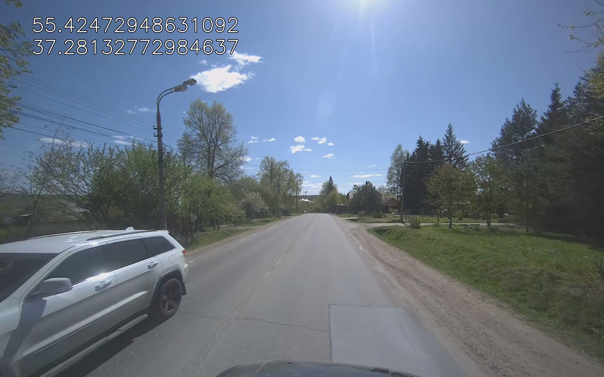
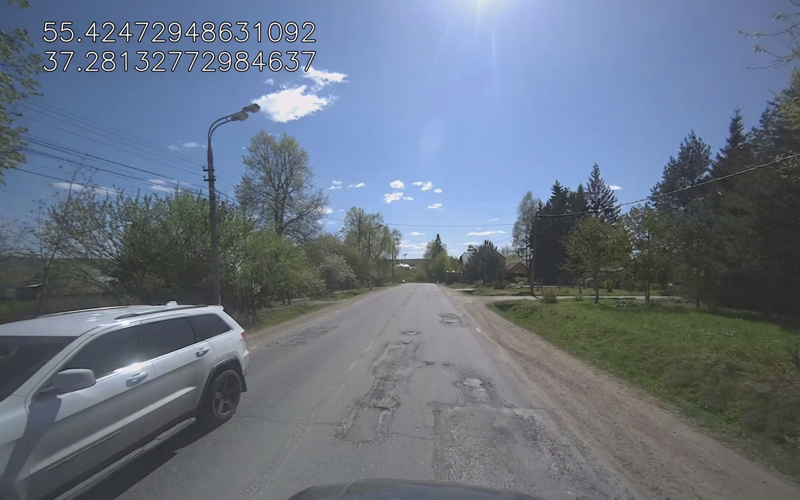
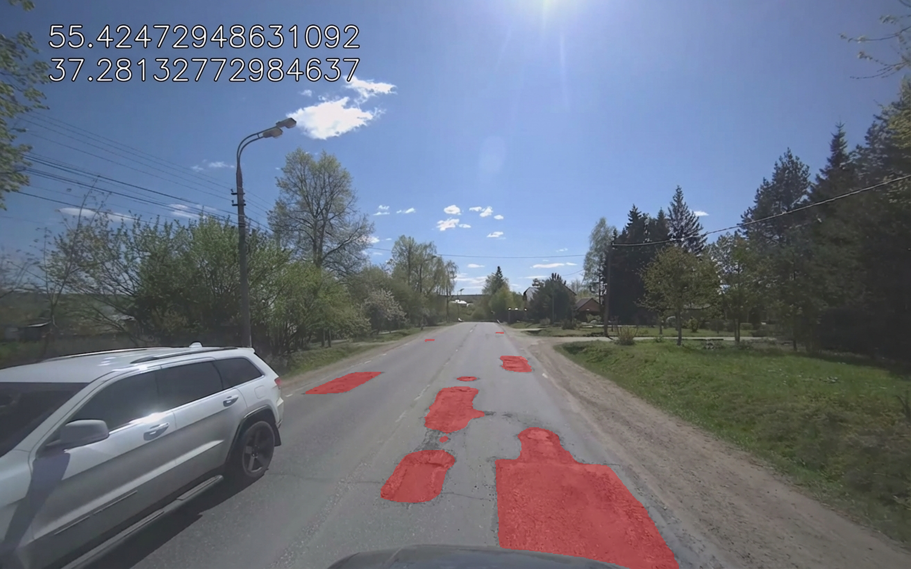

# Banana Road Synth

**English** | [Русский](README.ru.md)

Generate synthetic asphalt repair patches on real road photographs with **Nano Banana Pro**. The pipeline first proposes a binary mask, then asks the model to render worn patches in those locations. It saves the model output, a background-preserving composite and a mask overlay for review.

[Russian article](https://habr.com/ru/articles/993968/) · [Google image-generation guide](https://ai.google.dev/gemini-api/docs/generate-content/image-generation) · [API pricing](https://ai.google.dev/gemini-api/docs/pricing)

## A real scene, synthetic patches

| Original | Generated | Mask overlay |
| --- | --- | --- |
|  |  |  |
|  |  |  |
|  |  |  |

These are the original experiment's examples, not new API runs. The current script additionally composites generated pixels inside the binary mask; the examples above predate that step.

## Quick start

Python **3.10+** and Gemini API access with image generation enabled are required. Requests are billable; the offline checks do not call the API.

```bash
git clone https://github.com/HeinrichWirth/banana-road-synth.git
cd banana-road-synth
python -m venv .venv
```

Activate the environment with `source .venv/bin/activate` on macOS/Linux, or `.venv\Scripts\Activate.ps1` in Windows PowerShell, then install:

```bash
python -m pip install -r requirements.txt
```

Set `GEMINI_API_KEY` in your environment. For example, in macOS/Linux:

```bash
export GEMINI_API_KEY="your-api-key"
```

Or in PowerShell:

```powershell
$env:GEMINI_API_KEY = "your-api-key"
```

Keep the real key out of source files and commits. The script does not load `.env` files automatically.

Preview the inputs without sending anything to Google:

```bash
python generate.py --input ./input_images --output ./outputs --limit 1 --dry-run
```

Generate one candidate pair:

```bash
python generate.py --input ./input_images --output ./outputs --limit 1
```

Remove `--limit 1` to process the folder recursively. Use `--evening` and/or `--semseg` to enable the additional experiments. Each enabled option adds one image-generation request per new input.

## Processing

1. Load the photograph as RGB and apply its EXIF orientation.
2. Ask for a repair-patch mask; resize with nearest-neighbour interpolation and threshold at **128** to obtain values **0/255**.
3. Send the photograph and mask to the model to generate patches.
4. Resize the generated image to the source dimensions if necessary and save it in `generated/` for inspection.
5. Copy generated pixels inside the mask and original pixels outside it into `patches/`. Save as lossless PNG.
6. Produce a red overlay locally, with opacity **0.35**.
7. Optionally generate dusk lighting or an experimental semantic mask.

Compositing guarantees that decoded RGB pixels outside the mask stay unchanged in `patches/`. It does **not** guarantee that the model filled every masked pixel correctly: check patch boundaries, geometry and seams before treating the mask as a training label. The dusk output deliberately edits the whole image.

The semantic palette is black for background, blue for curbs, green for lane markings, red for crosswalks and white for signs. Colours are snapped to the nearest palette colour in RGB space. This standardises encoding, not semantic accuracy.

## Configuration and outputs

Prompts and defaults live in [`config.py`](config.py). `GEMINI_MODEL` overrides the model; the default is `gemini-3-pro-image`. The February 2026 experiment used `gemini-3-pro-image-preview`. Image output size is explicitly requested as **1K**; the final saved dimensions match the input. Resizing cannot restore detail absent from the generated output.

```text
outputs/
├── masks/       # proposed binary masks
├── generated/   # model output, resized to input dimensions
├── patches/     # composite retaining the original background
├── overlay/     # local visual check
├── metadata/    # source hash, model and prompts for resuming
├── evening/     # optional whole-scene relighting
└── semseg/      # optional experimental segmentation
```

Input `route_a/frame.jpg` becomes `route_a/frame.jpg.png` in each image folder. Keeping the relative directory and original extension avoids collisions with `route_b/frame.jpg` and `route_a/frame.png`.

Completed stages are reused. A changed source, model or prompt requires a **new output directory**, preventing a mixture of incompatible cached stages. If you manually edit cached outputs, also start a new output directory. Keep one process per output directory. A failed API stage stops the run; rerun after resolving the error. Missing images in API responses produce a clear error, not an empty label. Empty generated masks are rejected before the patch request.

## Cost

At the standard Pro rate used in the article, one 1K/2K output is **1,120 × $120 / 1,000,000 = $0.1344**. The basic two-request pipeline therefore costs **$0.2688 in image output**, before input, text/thinking output and retries. Both optional experiments increase that to **$0.5376** per source image. Local compositing and overlays make no API calls. Check [current prices](https://ai.google.dev/gemini-api/docs/pricing) before a run.

The dry run reports an upper bound on generation count, not a billing quote. This repository does not measure downstream model accuracy; evaluate synthetic-data training on held-out real images.

## Offline checks

```bash
python -m unittest discover -s tests -v
```

Tests cover mask thresholding, palette assignment, exact background preservation, missing responses, output naming, stage resumption and optional request counts. They use deterministic local fixtures; they do not measure model quality or spend API credits.

## License

[MIT](LICENSE).
